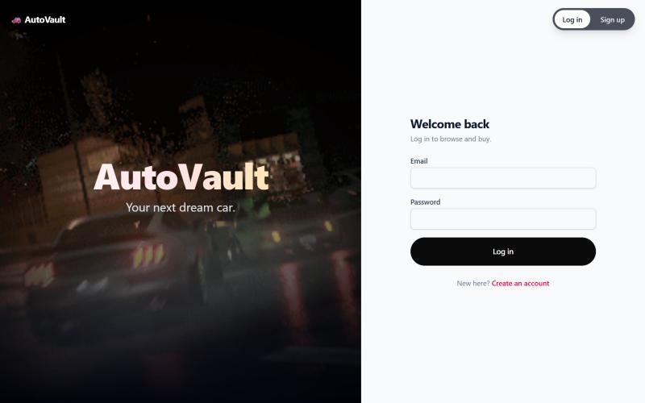
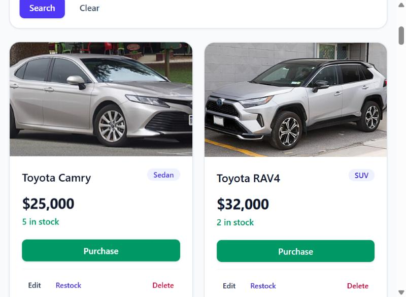
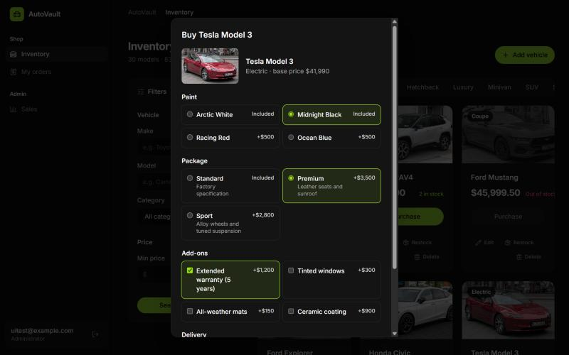
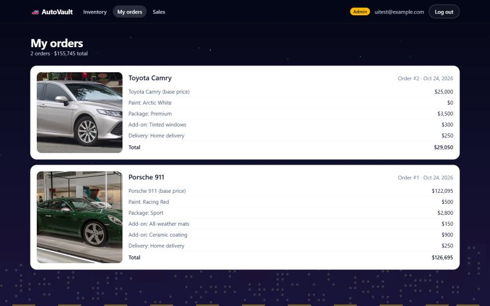
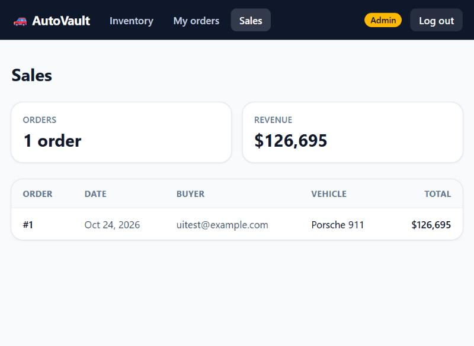
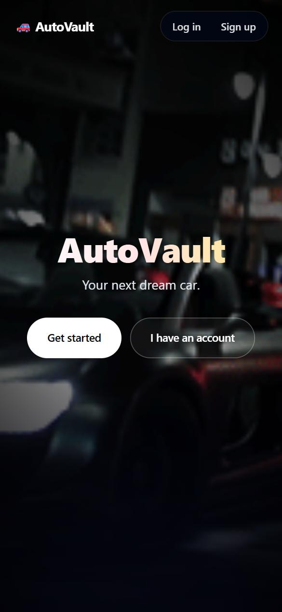

# AutoVault: Car Dealership Inventory System

[](https://github.com/sanjaym88/car-dealership-inventory/actions/workflows/ci.yml)

A full-stack inventory system for a car dealership, built test-first as a TDD kata. Customers register, browse
and search a showroom of 30 cars with real photos, customise and buy a car, and see their order history. Admins
manage the inventory and see every sale.

- **Backend:** FastAPI REST API with JWT authentication and role-based access, backed by PostgreSQL.
- **Frontend:** React + TypeScript single-page app styled with Tailwind CSS.
- **Quality:** 277 automated tests (130 backend, 147 frontend) at ~99% coverage, plus linting, run on every push by GitHub Actions.
- **Live demo:** https://car-dealership-inventory-x2si.vercel.app (the free backend sleeps when idle; the first request can take up to a minute)
- **One command to try it:** `docker compose --profile app up --build`, then open http://localhost:8080.


---

## Contents

- [Features](#features)
- [Screenshots](#screenshots)
- [Tech stack](#tech-stack)
- [Architecture](#architecture)
- [API reference](#api-reference)
- [Running locally](#running-locally)
- [Deployment](#deployment)
- [Running the tests](#running-the-tests)
- [Test report](#test-report)
- [Design decisions](#design-decisions)
- [Development process](#development-process)
- [My AI Usage](#my-ai-usage)

---

## Features

**Look and feel**
- Landing page: night-driving clips crossfade behind the headline, with a slow zoom.
- *Log in* and *Sign up* slide the clips aside and roll a garage door up to reveal the form.
- Calm, pill-shaped buttons with a slow, even ease, inspired by rivian.com, used consistently across the app.
- A quiet near-black night with stars and a drifting skyline sits behind every app page.
- Dialogs (checkout, admin forms) open where you are on the page, and the page behind stays still.
- Motion is turned off for anyone whose system asks for reduced motion.
- Deliberately plain: no gradient text, purple gradients, glassmorphism, emojis, icon packs or fade-in
  sections. `frontend/styleGuard.test.ts` scans the source and fails the build if any of them creep back.

**Everyone (logged in)**
- Register and log in; the session survives a page refresh and expired tokens are discarded cleanly.
- Sign-ups with an email domain that can't receive mail (typos like `gmial.con`, made-up domains) are rejected.
- Showroom of vehicles with photos, price, category and live stock, plus an inventory summary.
- Search and filter by make, model (partial, case-insensitive), category and price range.
- **Checkout:** *Purchase* opens a checkout where you choose paint, trim package, add-ons and delivery, with a
  live total. Confirming returns an itemised receipt with an order number. The button is disabled when a car is
  out of stock.
- **My orders:** every purchase with its photo, date, receipt and total.

**Admins**
- Add, edit (including a photo URL), restock and delete vehicles from dialogs on the dashboard.
- **Sales** page: order count, revenue, and every sale with its buyer.
- Admin controls and pages are hidden from regular users *and* enforced by the API (`403` for non-admins).

**Robustness**
- Validation on both sides: the frontend checks input before sending, and the API and the database
  (check constraints) enforce the same rules.
- Prices are always computed on the server. The browser sends only option codes, so a modified client can't
  change what it pays.
- A purchase takes the unit out of stock and records the order in one transaction, so two buyers can't both
  get the last car, and no order exists without its stock change.
- Orders keep a snapshot of the car and prices, so history stays correct if a car is later edited or deleted.
- Responsive layout from phone to desktop; accessible labels, dialogs and status messages.

## Screenshots

| Garage-door login with the car button | Inventory on the night theme |
|---|---|
|  |  |

| Checkout with customisation | My orders |
|---|---|
|  |  |

| Sales (admin) | Phone (landing) |
|---|---|
|  |  |

## Tech stack

| Layer | Technology |
|---|---|
| Backend | Python 3.12, FastAPI, SQLAlchemy 2, Alembic, Pydantic, PyJWT, bcrypt |
| Database | PostgreSQL 16 (Docker) |
| Frontend | React 19, TypeScript, Vite, Tailwind CSS 4, React Router |
| Testing | Pytest, pytest-cov, HTTPX/TestClient; Vitest, Testing Library, @vitest/coverage-v8 |
| Quality | Ruff (lint + format) for Python, oxlint for TypeScript |
| CI | GitHub Actions (backend lint, format check and tests against Postgres; frontend lint, tests and build) |
| Containers | Docker Compose: Postgres, API image, nginx serving the React build |

## Architecture

```
car/
├── backend/
│   ├── app/
│   │   ├── api/routes/     HTTP layer: auth.py, vehicles.py, orders.py
│   │   ├── api/deps.py     auth guard (get_current_user) and admin guard (require_admin)
│   │   ├── api/errors.py   maps domain errors to HTTP status codes in one place
│   │   ├── services/       business rules (Auth, Vehicle, Order services; checkout option catalog)
│   │   ├── repositories/   all database access (User, Vehicle, Order repositories)
│   │   ├── models/         SQLAlchemy tables (User, Vehicle, Order)
│   │   ├── schemas/        Pydantic request/response models and validation
│   │   ├── core/           settings, DB session, password hashing and JWT
│   │   └── scripts/        create_admin and seed_inventory CLIs
│   ├── alembic/            database migrations
│   └── tests/              pytest suite (runs against a real Postgres test DB)
├── frontend/src/
│   ├── api/                fetch client, typed endpoint functions, shared types
│   ├── auth/               AuthProvider, useAuth, ProtectedRoute, AdminRoute, token storage
│   ├── components/         VehicleCard, VehiclePhoto, SearchBar, CheckoutForm, VehicleForm, Modal, …
│   └── pages/              Login, Register, Dashboard, Checkout, My orders, Sales (+ hooks)
├── docs/                   screenshots and test report
└── docker-compose.yml      dev DB (5432) and test DB (5433)
```

A request flows **route → service → repository → database**. Each layer has one job, so business rules can be
read and tested without HTTP or SQL in the way, and storage could change without touching the rules.

## API reference

Interactive docs are served at `http://localhost:8000/docs` while the backend is running.

| Method | Path | Access | Description |
|---|---|---|---|
| POST | `/api/auth/register` | public | Create an account. `201`, `409` if the email exists, `422` if invalid |
| POST | `/api/auth/login` | public | Returns `{access_token, token_type}`. `401` for bad credentials |
| GET | `/api/auth/me` | logged in | The current user, including `is_admin` |
| GET | `/api/vehicles` | logged in | List all vehicles |
| GET | `/api/vehicles/search` | logged in | Filters: `make`, `model`, `category`, `min_price`, `max_price` |
| POST | `/api/vehicles` | logged in | Add a vehicle |
| PUT | `/api/vehicles/{id}` | logged in | Partial update |
| DELETE | `/api/vehicles/{id}` | **admin** | Delete a vehicle (`204`) |
| POST | `/api/vehicles/{id}/purchase` | logged in | Optional body `{color, package, addons, delivery}` (option codes). Stock −1, records an order, returns `{vehicle, order}`; `409` when out of stock, `422` for unknown options |
| POST | `/api/vehicles/{id}/restock` | **admin** | Body `{"quantity": n}`, stock +n |
| GET | `/api/checkout/options` | logged in | Paint, packages, add-ons and delivery with prices |
| GET | `/api/orders/me` | logged in | My orders, newest first, each with a line-item receipt |
| GET | `/api/orders` | **admin** | All orders with the buyer's email |

Every vehicle has a unique `id`, `make`, `model`, `category`, `price` (> 0), `quantity` (≥ 0) and an optional
`image_url` (http/https only).
Protected routes expect `Authorization: Bearer <token>`.

## Running locally

### Quickest: everything in Docker

**Prerequisite:** Docker Desktop.

```bash
docker compose --profile app up --build
```

Open http://localhost:8080. The API container migrates the database, seeds the 30-car showroom and creates a
demo admin (`admin@example.com` / `autovault-demo`; change them with the `ADMIN_EMAIL` and `ADMIN_PASSWORD`
environment variables). The API docs are at http://localhost:8080/docs. Stop everything with
`docker compose --profile app down`.

### For development

**Prerequisites:** Python 3.12, Node.js 24, Docker Desktop.

### 1. Start PostgreSQL

```bash
docker compose up -d        # dev DB on :5432, test DB on :5433
```

### 2. Backend

```bash
cd backend
python -m venv .venv
.venv\Scripts\activate                 # macOS/Linux: source .venv/bin/activate
pip install -r requirements-dev.txt
copy .env.example .env                 # macOS/Linux: cp .env.example .env  (set JWT_SECRET)
alembic upgrade head                   # create the tables
python -m app.scripts.seed_inventory   # 30 cars with photos (add --no-photos to work offline)
python -m app.scripts.create_admin --email admin@example.com   # prompts for a password
uvicorn app.main:app --reload          # API on http://localhost:8000
```

- `create_admin` creates an admin, or promotes an existing user. Registration through the API never grants admin.
- `seed_inventory` is safe to re-run. It adds missing cars and fills in missing photos, but never changes existing
  prices or stock.

### 3. Frontend

```bash
cd frontend
npm install
npm run dev                            # http://localhost:5173 (proxies /api to :8000)
```

Open http://localhost:5173. Register a regular account, or log in as the admin you created.

## Deployment

**Live demo:** https://car-dealership-inventory-x2si.vercel.app

> The backend runs on Render's free plan and goes to sleep after 15 minutes without traffic. The first request
> after that can take about a minute while it wakes up.

```
Browser ──▶ Vercel (React build) ──/api/*──▶ Render (FastAPI) ──▶ Neon (PostgreSQL)
```

| Part | Host | Config |
|---|---|---|
| Frontend | Vercel (root directory `frontend`) | [`frontend/vercel.json`](frontend/vercel.json) proxies `/api/*` to the backend and serves `index.html` for client routes |
| Backend | Render free web service | [`render.yaml`](render.yaml) Blueprint: migrations run on start, health check `/api/health` |
| Database | Neon free Postgres | Connection string goes in Render's `DATABASE_URL` (the `postgres://` scheme is converted automatically) |

Because Vercel proxies `/api`, the browser only talks to one origin, so no CORS setup is needed. In production
(`ENVIRONMENT=production`) the API refuses to start without a strong `JWT_SECRET`; Render generates one.

On every start the API runs the same script as the Docker image (`backend/docker-entrypoint.sh`): it
migrates, seeds the 30-car catalog (adding only what's missing), and creates an admin if `ADMIN_EMAIL` and
`ADMIN_PASSWORD` are set under the Render service's *Environment* tab.

## Running the tests

```bash
# backend (needs the db_test container from docker compose)
cd backend
pytest --cov --cov-report=term-missing
ruff check . && ruff format --check .
python scripts/stress_test.py          # 20 hostile scenarios over HTTP against the Docker stack (:8080)

# frontend
cd frontend
npm run test:coverage                  # or: npm test (watch mode)
npm run lint
npm run build
```

## Test report

All tests pass; full output is in [`docs/test-report/`](docs/test-report/).

| Suite | Tests | Result | Coverage |
|---|---|---|---|
| Backend (pytest, real PostgreSQL) | 130 | All passed | 99% of statements |
| Frontend (Vitest + Testing Library) | 147 | All passed | 99.0% statements · 95.6% branches |

What is covered:
- **Auth:** registration rules, bcrypt hashing, login, identical errors for unknown email and wrong password,
  and forged, expired or orphaned tokens.
- **Authorization:** `401` vs `403` on every protected route, and admin-only delete and restock.
- **Vehicles:** CRUD validation (missing fields, non-positive price, negative quantity, blank text), partial
  updates, and `404`s.
- **Search:** each filter, combined filters, inclusive price bounds, literal `%`/`_`, and invalid ranges.
- **Inventory:** purchase down to zero, `409` when sold out, restock validation.
- **Concurrency:** 20 buyers on separate database connections, released at the same instant, race for a car
  with 5 in stock. Exactly 5 succeed, stock ends at 0, and there are exactly 5 orders. To check the test can
  catch the bug, a naive read-then-write purchase was swapped in temporarily: it sold 20 cars out of 5.
- **Black-box stress run** (`backend/scripts/stress_test.py`): 20 hostile scenarios over real HTTP against the
  running stack. The first run passed 16/20 and exposed duplicate accounts differing only in email case, 500s
  from oversized numbers and ids, and no login throttling. All four are now fixed with tests (20/20).
- **Email domains:** undeliverable domains rejected at sign-up (DNS faked in tests), the check switchable,
  login unaffected, and the admin script exempt.
- **Checkout and orders:** option catalog, server-side totals and receipts, defaults, unknown options rejected
  without buying, client prices ignored, no order on a failed purchase, own-orders-only history, admin sales,
  and history surviving vehicle deletion.
- **Seeding and photos:** idempotent seeding, never overwriting data, and the Wikipedia photo lookup (including
  failures and offline).
- **Frontend:** API client error handling, session restore, route guards, form validation, checkout with live
  totals and receipt, order history and sales pages, and every dashboard flow (search, purchase, add, edit,
  restock, delete), with user and admin views.

Raw output: [backend.txt](docs/test-report/backend.txt) · [frontend.txt](docs/test-report/frontend.txt)

## Design decisions

- **Atomic purchases.** Buying runs `UPDATE … SET quantity = quantity - 1 WHERE id = ? AND quantity > 0` and
  inserts the order in the same transaction. If no row is updated, the vehicle is either missing (`404`) or sold
  out (`409`) and nothing is recorded. There is no read-then-write race.
- **The server owns the prices.** The option catalog lives in one backend module. Checkout sends option codes
  only, and the API prices them, stores the receipt as line items, and ignores any price field from the client.
  The total shown during checkout is an estimate from the same catalog.
- **Orders are snapshots.** An order copies the make, model, photo and prices at purchase time. Its link to the
  vehicle uses `ON DELETE SET NULL`, so deleting or repricing a car never rewrites anyone's history.
- **No account enumeration.** Login returns the same `401 Invalid email or password` whether the email is
  unknown or the password is wrong.
- **Who can do what.** The kata marks only DELETE and restock as admin-only, so the API follows that; add and
  edit need a login. The UI shows add, edit, restock and delete to admins only.
- **Defence in depth.** The same rules live in the Pydantic schemas, in database check constraints
  (`price > 0`, `quantity >= 0`) and in the frontend forms, which check locally for quick feedback.
- **Tests against real PostgreSQL**, not SQLite or in-memory. Each test runs inside a transaction that is rolled
  back, so tests are isolated and fast. bcrypt cost is lowered only in tests (production keeps 12), which cut
  the suite from about 50s to about 3s.
- **Domain errors, not HTTP, in services.** Services raise `VehicleNotFoundError` or `OutOfStockError`;
  `api/errors.py` maps them to status codes in one place.

**Email checks and their limit:** registration checks that the email is well-formed *and* that its domain has
mail servers. If DNS can't be reached the address is allowed, so an outage never blocks sign-ups. It still can't
prove the mailbox exists or belongs to the user; that needs an emailed confirmation link and an
email-sending service.

**Landing-page clips:** the three night-driving GIFs in `frontend/src/assets/hero/` were supplied for this
demo and belong to their original creators (one carries an *Art of the Automobile* watermark). Replace them
before any public or commercial use.

**Photo credits:** car photos are the lead images of the models' Wikipedia articles, hosted on
[Wikimedia Commons](https://commons.wikimedia.org/) under their respective free licences (mostly CC BY-SA).
Each file's author and licence are on its Commons page.

## Development process

Built with test-driven development. Each feature went through **Red → Green → Refactor**, and the commit history
shows it:

```
test: add failing tests for purchase and restock          ← red
feat: implement purchase and restock endpoints            ← green
refactor(tests): cut test suite time from ~50s to ~3s     ← refactor
```

Commits made with AI assistance carry a `Co-Authored-By` trailer, and their messages say what the AI did.

## My AI Usage

<!-- Write this section yourself; it should reflect your own experience. -->

### Tools used
_TODO: which AI tools and models you used._

### How I used them
_TODO: what you asked the AI to do (planning, scaffolding, tests, implementation, debugging, docs), and
what you wrote, decided or changed yourself._

### Reflection
_TODO: what sped you up, what you had to verify or correct, what you learned, and what you would do
differently._

Raw chat logs are in [PROMPTS.md](PROMPTS.md).
