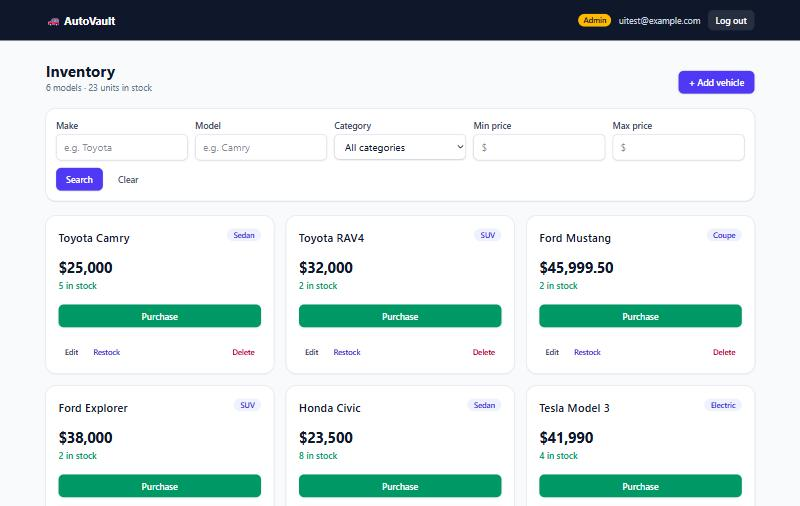
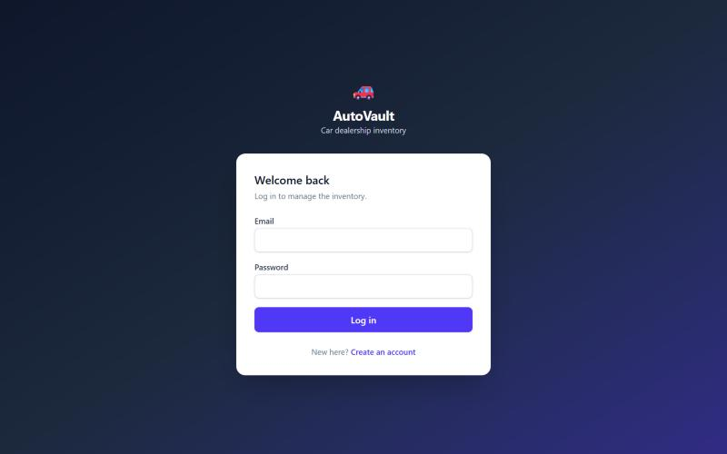
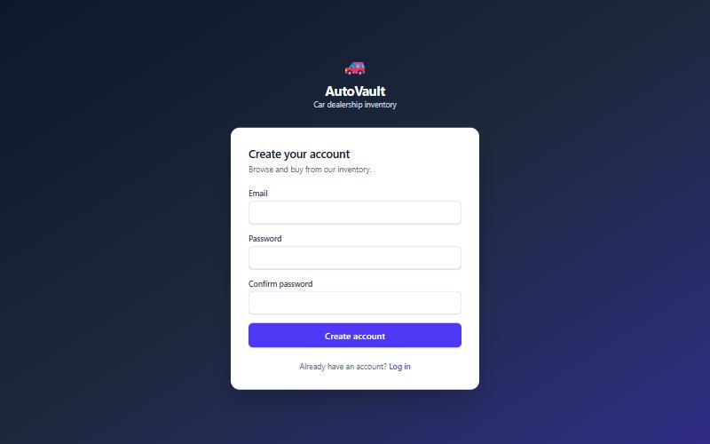
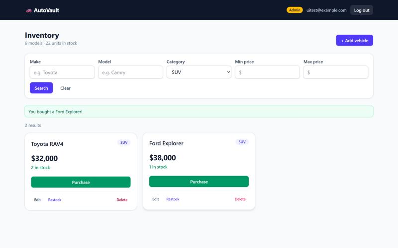
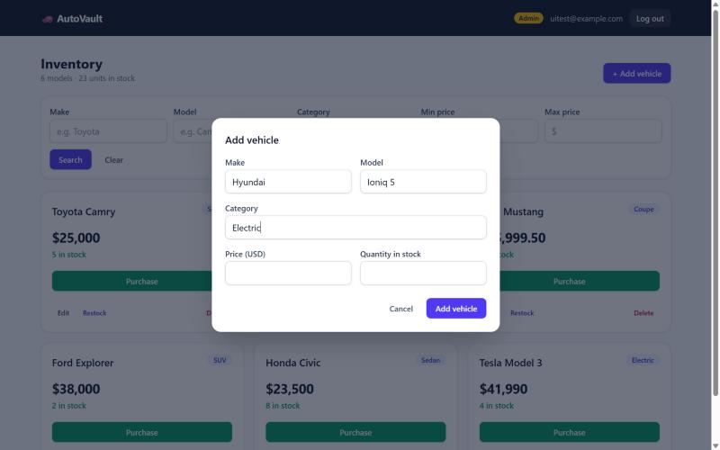
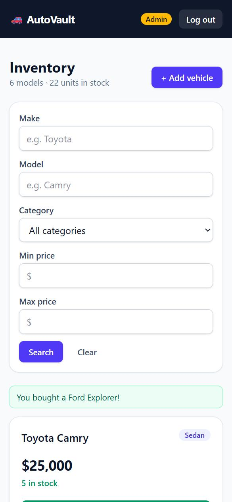

# AutoVault: Car Dealership Inventory System

[](https://github.com/sanjaym88/car-dealership-inventory/actions/workflows/ci.yml)

A full-stack inventory system for a car dealership, built test-first as a TDD kata. Customers register, browse
and search the inventory, and buy vehicles; admins add, edit, restock and delete them.

- **Backend:** FastAPI REST API with JWT authentication and role-based access, backed by PostgreSQL.
- **Frontend:** React + TypeScript single-page app styled with Tailwind CSS.
- **Quality:** 167 automated tests (78 backend, 89 frontend) at ~99% coverage, run on every push by GitHub Actions.



---

## Contents

- [Features](#features)
- [Screenshots](#screenshots)
- [Tech stack](#tech-stack)
- [Architecture](#architecture)
- [API reference](#api-reference)
- [Running locally](#running-locally)
- [Running the tests](#running-the-tests)
- [Test report](#test-report)
- [Design decisions](#design-decisions)
- [Development process](#development-process)
- [My AI Usage](#my-ai-usage)

---

## Features

**Everyone (logged in)**
- Register and log in; the session survives a page refresh and expired tokens are discarded cleanly.
- Dashboard of all vehicles with price, category and live stock, plus an inventory summary.
- Search and filter by make, model (partial, case-insensitive), category and price range.
- **Purchase** a vehicle; the button is disabled when it is out of stock.

**Admins**
- Add, edit, restock and delete vehicles from dialogs on the dashboard.
- Admin controls are hidden from regular users *and* enforced by the API (`403` for non-admins).

**Robustness**
- Validation on both sides: the frontend checks input before sending, and the API and the database
  (check constraints) enforce the same rules.
- Purchases are atomic, so two buyers can't both get the last car.
- Responsive layout from phone to desktop; accessible labels, dialogs and status messages.

## Screenshots

| Login | Register |
|---|---|
|  |  |

| Search + purchase confirmation | Add vehicle (admin) |
|---|---|
|  |  |

<p align="center"></p>

## Tech stack

| Layer | Technology |
|---|---|
| Backend | Python 3.12, FastAPI, SQLAlchemy 2, Alembic, Pydantic, PyJWT, bcrypt |
| Database | PostgreSQL 16 (Docker) |
| Frontend | React 19, TypeScript, Vite, Tailwind CSS 4, React Router |
| Testing | Pytest, pytest-cov, HTTPX/TestClient; Vitest, Testing Library, @vitest/coverage-v8 |
| CI | GitHub Actions (backend tests against Postgres; frontend lint, tests and build) |

## Architecture

```
car/
├── backend/
│   ├── app/
│   │   ├── api/routes/     HTTP layer: auth.py, vehicles.py
│   │   ├── api/deps.py     auth guard (get_current_user) and admin guard (require_admin)
│   │   ├── api/errors.py   maps domain errors to HTTP status codes in one place
│   │   ├── services/       business rules (AuthService, VehicleService), no HTTP or SQL
│   │   ├── repositories/   all database access (UserRepository, VehicleRepository)
│   │   ├── models/         SQLAlchemy tables (User, Vehicle)
│   │   ├── schemas/        Pydantic request/response models and validation
│   │   ├── core/           settings, DB session, password hashing and JWT
│   │   └── scripts/        create_admin CLI
│   ├── alembic/            database migrations
│   └── tests/              pytest suite (runs against a real Postgres test DB)
├── frontend/src/
│   ├── api/                fetch client, typed endpoint functions, shared types
│   ├── auth/               AuthProvider, useAuth, ProtectedRoute, token storage
│   ├── components/         VehicleCard, SearchBar, VehicleForm, Modal, …
│   └── pages/              Login, Register, Dashboard (+ useInventory hook, AdminDialogs)
├── docs/                   screenshots and test report
└── docker-compose.yml      dev DB (5432) and test DB (5433)
```

A request flows **route → service → repository → database**. Each layer has one job, so business rules can be
read and tested without HTTP or SQL in the way, and storage could change without touching the rules.

## API reference

Interactive docs are served at `http://localhost:8000/docs` while the backend is running.

| Method | Path | Access | Description |
|---|---|---|---|
| POST | `/api/auth/register` | public | Create an account. `201`, `409` if the email exists, `422` if invalid |
| POST | `/api/auth/login` | public | Returns `{access_token, token_type}`. `401` for bad credentials |
| GET | `/api/auth/me` | logged in | The current user, including `is_admin` |
| GET | `/api/vehicles` | logged in | List all vehicles |
| GET | `/api/vehicles/search` | logged in | Filters: `make`, `model`, `category`, `min_price`, `max_price` |
| POST | `/api/vehicles` | logged in | Add a vehicle |
| PUT | `/api/vehicles/{id}` | logged in | Partial update |
| DELETE | `/api/vehicles/{id}` | **admin** | Delete a vehicle (`204`) |
| POST | `/api/vehicles/{id}/purchase` | logged in | Stock −1; `409` when out of stock |
| POST | `/api/vehicles/{id}/restock` | **admin** | Body `{"quantity": n}`, stock +n |

Every vehicle has a unique `id`, `make`, `model`, `category`, `price` (> 0) and `quantity` (≥ 0).
Protected routes expect `Authorization: Bearer <token>`.

## Running locally

**Prerequisites:** Python 3.12, Node.js 24, Docker Desktop.

### 1. Start PostgreSQL

```bash
docker compose up -d        # dev DB on :5432, test DB on :5433
```

### 2. Backend

```bash
cd backend
python -m venv .venv
.venv\Scripts\activate                 # macOS/Linux: source .venv/bin/activate
pip install -r requirements-dev.txt
copy .env.example .env                 # macOS/Linux: cp .env.example .env  (set JWT_SECRET)
alembic upgrade head                   # create the tables
python -m app.scripts.create_admin --email admin@example.com   # prompts for a password
uvicorn app.main:app --reload          # API on http://localhost:8000
```

`create_admin` creates an admin, or promotes an existing user. Registration through the API never grants admin.

### 3. Frontend

```bash
cd frontend
npm install
npm run dev                            # http://localhost:5173 (proxies /api to :8000)
```

Open http://localhost:5173. Register a regular account, or log in as the admin you created.

## Running the tests

```bash
# backend (needs the db_test container from docker compose)
cd backend
pytest --cov --cov-report=term-missing

# frontend
cd frontend
npm run test:coverage                  # or: npm test (watch mode)
npm run lint
npm run build
```

## Test report

All tests pass; full output is in [`docs/test-report/`](docs/test-report/).

| Suite | Tests | Result | Coverage |
|---|---|---|---|
| Backend (pytest, real PostgreSQL) | 78 | ✅ all passed | 99% of statements |
| Frontend (Vitest + Testing Library) | 89 | ✅ all passed | 99.1% statements · 95.8% branches |

What is covered:
- **Auth:** registration rules, bcrypt hashing, login, identical errors for unknown email and wrong password,
  and forged, expired or orphaned tokens.
- **Authorization:** `401` vs `403` on every protected route, and admin-only delete and restock.
- **Vehicles:** CRUD validation (missing fields, non-positive price, negative quantity, blank text), partial
  updates, and `404`s.
- **Search:** each filter, combined filters, inclusive price bounds, literal `%`/`_`, and invalid ranges.
- **Inventory:** purchase down to zero, `409` when sold out, restock validation.
- **Frontend:** API client error handling, session restore, route guards, form validation and every dashboard
  flow (search, purchase, add, edit, restock, delete), with user and admin views.

Raw output: [backend.txt](docs/test-report/backend.txt) · [frontend.txt](docs/test-report/frontend.txt)

## Design decisions

- **Atomic stock changes.** Purchase is a single `UPDATE … SET quantity = quantity - 1 WHERE id = ? AND
  quantity > 0`. If no row is updated, the vehicle is either missing (`404`) or sold out (`409`). There is no
  read-then-write race.
- **No account enumeration.** Login returns the same `401 Invalid email or password` whether the email is
  unknown or the password is wrong.
- **Who can do what.** The kata marks only DELETE and restock as admin-only, so the API follows that; add and
  edit need a login. The UI shows add, edit, restock and delete to admins only.
- **Defence in depth.** The same rules live in the Pydantic schemas, in database check constraints
  (`price > 0`, `quantity >= 0`) and in the frontend forms, which check locally for quick feedback.
- **Tests against real PostgreSQL**, not SQLite or in-memory. Each test runs inside a transaction that is rolled
  back, so tests are isolated and fast. bcrypt cost is lowered only in tests (production keeps 12), which cut
  the suite from about 50s to about 3s.
- **Domain errors, not HTTP, in services.** Services raise `VehicleNotFoundError` or `OutOfStockError`;
  `api/errors.py` maps them to status codes in one place.

## Development process

Built with test-driven development. Each feature went through **Red → Green → Refactor**, and the commit history
shows it:

```
test: add failing tests for purchase and restock          ← red
feat: implement purchase and restock endpoints            ← green
refactor(tests): cut test suite time from ~50s to ~3s     ← refactor
```

Commits made with AI assistance carry a `Co-Authored-By` trailer, and their messages say what the AI did.

## My AI Usage

<!-- Write this section yourself; it should reflect your own experience. Prompts to answer: -->

### Tools used
_TODO_

### How I used them
_TODO_

### Reflection
_TODO_

Raw chat logs are in [PROMPTS.md](PROMPTS.md).
